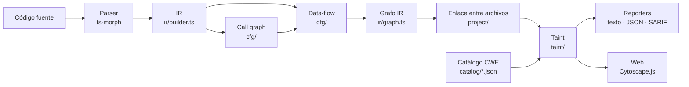

# Arquitectura

Resumen para orientarse en el código. El diseño original y sus decisiones
(ADR) están en [`docs/arquitectura/`](docs/arquitectura/); este archivo
describe el estado actual.

## Pipeline



1. **Parser** (`parser/`). Texto → `SourceFile` de ts-morph, en un sistema
   de archivos en memoria. Un archivo con errores de sintaxis es un error del
   escaneo, no un archivo limpio.
2. **IR** (`ir/`). El AST se reduce a cinco tipos de nodo: `Function`,
   `Parameter`, `Variable`, `Literal`, `Call`. Cada nodo lleva su ubicación y
   su cadena de ámbitos léxicos (`scopePath`). Las escrituras peligrosas
   (`el.innerHTML = x`, `dangerouslySetInnerHTML`) se modelan como llamadas.
   El id de un nodo es `archivo#Tipo@línea:col` (en un `Call`, la posición del
   paréntesis de los argumentos, para que las llamadas encadenadas no
   compartan id).
3. **Call graph** (`cfg/`). Cada llamada se resuelve contra las funciones del
   código analizado (`FunctionIndex.resolve`): por nombre, por `this.m()`, por
   contenedor (`Clase.m()`, `objeto.m()`) o, como heurística, por el único
   método con ese nombre. Las resoluciones exactas y las heurísticas se marcan
   distinto (`resolution: "exact" | "guess"`).
4. **Data-flow** (`dfg/`). Aristas `FLOWS_TO` def → uso dentro del ámbito
   léxico (con closures y sombreado); `BINDS_TO` argumento → parámetro;
   `RETURNS` valor retornado → llamada. En una llamada resuelta con certeza,
   el valor de la llamada sale solo de lo que la función retorna.
5. **Enlace entre archivos** (`project/`). Imports de ES y CommonJS, alias de
   `tsconfig`/`jsconfig` e `import()` dinámico. Los archivos unidos por
   llamadas forman un componente y se analizan como un solo grafo.
6. **Taint** (`taint/`). Sources, sinks y sanitizers salen del catálogo.
   `annotateTaint` decide la CWE y los argumentos peligrosos de cada sink y
   para qué CWE vale cada sanitizer; `analyzeTaint` busca, por BFS acotado, un
   camino source → sink con los sanitizers de esa CWE quitados del grafo.
7. **Salida**. `scan/reporters/` (texto, JSON, SARIF 2.1.0), la API local
   (`server/`) y la versión web (`packages/viz`, el análisis corre en un Web
   Worker). Con `NEO4J_URI`, la API persiste el grafo y ejecuta la misma
   detección como consulta Cypher (`store/`).

## Tipos de arista

| Arista | De → a | Propaga taint |
|---|---|---|
| `FLOWS_TO` | def → uso (variable, argumento de una llamada no resuelta) | sí |
| `SANITIZED_BY` | `FLOWS_TO` que sale de un sanitizer (solo para la vista) | sí |
| `BINDS_TO` | argumento → parámetro de la función llamada | sí |
| `RETURNS` | valor retornado → llamada | sí |
| `CALLS` | llamada → función | sí (sin efecto: la función no tiene aristas de salida) |

Una arista `FLOWS_TO` hacia una llamada guarda por qué argumento entra el dato
(`arg`, -1 si es el receptor), para los sinks que solo son peligrosos en
algunos argumentos.

## Dónde está cada cosa

```
catalog/              familias CWE: sources, sinks y sanitizers (JSON)
packages/core/src/
  parser/             texto → SourceFile
  ir/                 AST → IR; expressions.ts extrae las raíces de flujo
  cfg/                resolución de llamadas (resolve.ts) y call graph
  dfg/                data-flow, ámbitos (scope.ts) e inter-procedural
  project/            imports/exports, tsconfig, enlace entre archivos
  taint/              reglas, alcanzabilidad (reach.ts) y detección
  catalog/            carga del catálogo y reglas a partir de él
  scan/               descubrimiento de archivos, escaneo y reporters
  engine/             motor en memoria o Neo4j, veredicto
  store/              persistencia y consulta Cypher
  server/             API local (graphsast serve)
  cli/                binario graphsast
  eval/               benchmark sintético, CVEs reales, línea de base
packages/viz/         versión web (Vite + Cytoscape.js)
```

## Decisiones que conviene conocer antes de cambiar algo

- **Sin type checker.** Construirlo cuesta ~1 s por archivo. Los sinks se
  reconocen por el texto del callee, con restricciones del catálogo
  (argumentos, llamada suelta, receptor, paquete de origen) para evitar los
  falsos positivos conocidos.
- **Insensible a campos y al orden.** `o.q` y `o` son el mismo dato, y una
  variable compartida acumula todo lo que se escribe en ella. Es lo que hace
  barato el análisis; los costos están en las Limitaciones del README.
- **El core corre en el navegador.** Nada en `ir/`, `cfg/`, `dfg/`,
  `project/`, `taint/` ni `scan/scan-files.ts` puede usar `node:*`; las rutas
  se manejan con `util/posix-path.ts`. Lo que importa la página (no el worker)
  no puede arrastrar ts-morph: ver `project/config-name.ts`.
- **Dos motores, mismas reglas.** Lo que el motor en memoria decide sin
  recorrer el grafo va en `annotateTaint`, y el motor Neo4j persiste ese
  resultado en vez de reimplementarlo.
